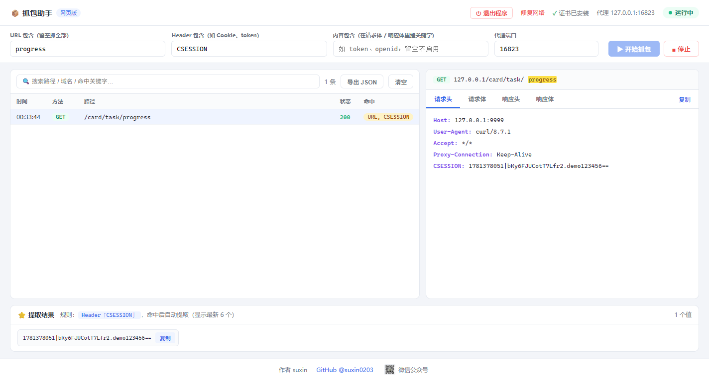

<div align="center">

# 📦 抓包助手（网页版）

**一键运行的本地 HTTPS 抓包工具 —— 网页就是界面，专为「快速抓一个 token/cookie」设计**

[](https://github.com/suxin0203/web-packet-capture)
[](https://www.python.org/)
[](https://mitmproxy.org/)
[](LICENSE)

一键运行 · 网页操作 · 关键字过滤 · token 自动提取 · 防断网自愈



</div>

---

## ✨ 特性

- **网页即界面**：本地起一个服务，浏览器自动打开，实时流量列表 + 请求/响应详情
- **三维度过滤**：URL 包含 / Header 包含 / 内容包含（请求体+响应体），AND 组合，运行中实时生效
- **token 自动提取**：按 Header 名自动从流量中提取命中值，去重展示，一键复制
- **请求体智能排版**：JSON / 表单体（`k=v&k=v`）自动识别并解析成树状缩进，不依赖 Content-Type
- **请求头修改**：高级设置里配置「名称=值」，发出的请求自动注入/覆盖（改 UA 等场景）
- **关键字高亮**：列表、请求头、请求体、响应体里全部高亮
- **防断网四重保护**：
  1. 退出时恢复**开启前的原状**（原来有代理就还原原代理）
  2. 强杀进程残留代理 → 下次启动自动检测清理（只清理本工具端口段，不误伤他人代理）
  3. 黑窗口被点 X → Win32 钩子抢 5 秒清理窗口
  4. 界面/脚本双重「修复网络」紧急按钮
- **心跳自动退出**：关闭所有网页标签页 10 秒后服务自动退出并恢复网络（可配置关闭，挂机抓包用）
- **端口永不冲突**：默认 16823/16824 避开常用端口，被占用自动顺延；停止后端口秒级释放
- **完整日志**：控制台实时流量行（时间/方法/状态/耗时/地址）+ `logs/service.log` 滚动文件日志（含 mitmproxy 内部错误），远程出问题发日志就能排障
- **新手友好**：首次启动自动弹出「三步上手」指南，右上角随时重看；配置全部界面化，无需碰文件
- **自动检测更新**：自动检查 GitHub Releases，发现新版本页面顶部提示一键前往下载
- **证书自动安装**：启动时自动生成并安装证书，确认框自动置顶不会被挡；管理员运行则完全静默无弹窗

## 🚀 快速开始

### 方式一：直接下载 EXE（推荐，无需 Python）

从 [Releases](https://github.com/suxin0203/web-packet-capture/releases) 下载压缩包，解压后双击 `抓包工具网页版.exe` 即可。

> 双击后若弹出 UAC（用户账户控制）窗口点「是」→ 以管理员运行，**证书静默安装全程无弹窗**；点「否」也能正常使用（证书走一次确认框）。不想要 UAC 可在 `config.ini` 设 `RUN_AS_ADMIN=0`。

### 方式二：源码运行

```bash
git clone https://github.com/suxin0203/web-packet-capture.git
cd web-packet-capture
pip install -r requirements.txt
双击 启动网页版.bat   # 或 python server.py
```

浏览器会自动打开 `http://127.0.0.1:16824`，点「▶ 开始抓包」即可。

## 📖 使用说明

| 过滤条件 | 作用 | 示例 |
|---|---|---|
| URL 包含 | 只抓网址含关键字的请求 | `progress`、`/api/login` |
| Header 包含 | 只抓带某请求头的请求 | `Cookie`、`CSESSION` |
| 内容包含 | 在请求体/响应体里搜关键字 | `token`、`openid` |

- 点任意请求查看详情（请求头/请求体/响应头/响应体），关键字黄色高亮
- 底部「⭐ 提取结果」按 Header 关键字自动提取命中值，点击复制
- 「导出 JSON」导出全部记录；抓包明细自动落盘 `logs/*.jsonl`

### 退出方式（都安全，不会断网）

| 操作 | 效果 |
|---|---|
| 「■ 停止」 | 只停抓包，服务保留，可改条件再抓 |
| 「⏻ 退出程序」 | 停抓包 + 恢复网络 + 服务退出 |
| 关闭所有网页标签 | 10 秒后服务自动退出并恢复网络 |
| Ctrl+C / 关黑窗口 | 退出并恢复网络（强杀有 5 秒清理钩子 + 启动自愈兜底） |

## 🔧 工作原理

```
浏览器 (http://127.0.0.1:16824)
   │  HTTP API + WebSocket 实时推送
   ▼
FastAPI 服务 (server.py)
   │  后台线程 + asyncio
   ▼
mitmproxy 引擎 (capture_addon.py, 127.0.0.1:16823)
   │  系统代理 / TLS 解密 (自动装证书)
   ▼
目标流量（小程序 / 浏览器 / 手机模拟器…）
```

- 核心抓包能力由 [mitmproxy](https://mitmproxy.org/) 提供，本项目只是它的极简「网页壳」
- 界面修改过滤条件实时生效，无需重启

## 📁 项目结构

```
├── server.py                  # 服务：Web 界面 + REST/WS + 引擎管理 + 代理/证书 + 日志系统
├── capture_addon.py           # mitmproxy 插件：过滤 / 记录 / 请求体识别 / 控制台流量行
├── web/
│   ├── index.html             # 网页界面（无框架，单文件）
│   └── qrcode.jpg             # 公众号二维码
├── config.ini                 # 配置（与界面双向同步，首次运行自动生成）
├── logs/                      # service.log 运行日志 + *.jsonl 抓包记录（git 忽略）
├── docs/                      # 文档
│   ├── screenshot.png         # 界面截图
│   ├── 使用说明.md             # 详细使用文档
│   ├── 操作手册.txt            # 随 EXE 分发的快速上手手册
│   └── 常见问题排查.txt        # 证书/网络排查
├── 启动网页版.bat              # 源码运行入口（双击）
├── 打包网页版.bat              # PyInstaller 打包成单文件 EXE
└── 强制关闭代理-断网修复.bat    # 紧急恢复网络
```

## ⚙️ 设置

界面可调：三个过滤框、代理端口、「自动设置系统代理」、「关网页自动退出」、「高级设置 · 请求头修改」，修改自动保存到 `config.ini`（一般无需手动编辑）。高级用户也可直接改配置文件：

| 配置 | 默认 | 说明 |
|---|---|---|
| `TARGET_URL` / `HEADER_KEY` / `BODY_KEY` | 空 | 对应界面三个过滤框 |
| `PROXY_PORT` / `WEB_PORT` | 16823 / 16824 | 被占用自动顺延 |
| `ENABLE_SYSTEM_PROXY` | 1 | 0 = 不自动改系统代理（手机手动配代理场景） |
| `AUTO_SHUTDOWN_WHEN_NO_BROWSER` | 1 | 0 = 关网页后服务常驻（挂机抓包） |
| `RUN_AS_ADMIN` | 1 | 0 = 启动时不请求管理员权限（不弹 UAC） |

## ❓ 常见问题

- **列表没数据？** 先清空三个过滤框（条件太严会全滤掉）；HTTPS 需点顶部证书徽标安装证书。
- **电脑断网了？** 双击 `强制关闭代理-断网修复.bat`，或点界面右上角「修复网络」。
- **手机抓包？** 手机与电脑同 WiFi，手机代理指向 `电脑IP:16823`，并把 `ENABLE_SYSTEM_PROXY` 设为 0。
- 更多见 [docs/操作手册.txt](docs/操作手册.txt)、[docs/使用说明.md](docs/使用说明.md) 与 [docs/常见问题排查.txt](docs/常见问题排查.txt)。

## ⚠️ 免责声明

本项目仅供**学习研究**和**自己拥有/已授权**的流量分析使用，请遵守当地法律法规，勿用于非法用途。抓包数据包含敏感信息（cookie/token），请注意保管。

## 👤 作者

**suxin**

- GitHub: [@suxin0203](https://github.com/suxin0203)
- 微信公众号：打开程序，点右下角「微信公众号」扫码关注

## 📄 License

[MIT](LICENSE) © suxin0203
